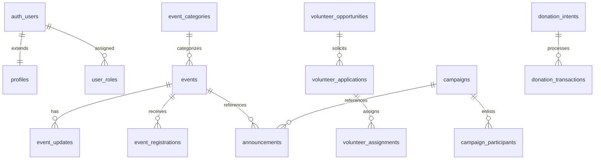

# SAMASTHA LIVE (1926–2026) DATABASE SCHEMA DOCUMENTATION

## 1. Relational Entity Overview

The database contains 18 normalized tables organized into 9 logical domains.

---

## 2. Table Specifications

### 2.1 Profiles & RBAC

#### `public.profiles`
App profile details linked directly to Supabase `auth.users(id)`:
- `id`: UUID (PK, references `auth.users(id)` ON DELETE CASCADE)
- `full_name`: TEXT NOT NULL
- `full_name_ml`: TEXT NULL (Malayalam representation)
- `phone`: TEXT NULL
- `email`: TEXT NULL
- `avatar_url`: TEXT NULL
- `created_at`: TIMESTAMPTZ NOT NULL DEFAULT NOW()
- `updated_at`: TIMESTAMPTZ NOT NULL DEFAULT NOW()

#### `public.user_roles`
Normalized role assignments preventing privilege escalation:
- `id`: UUID (PK DEFAULT gen_random_uuid())
- `user_id`: UUID NOT NULL REFERENCES `auth.users(id)` ON DELETE CASCADE
- `role`: TEXT NOT NULL CHECK in (`super_admin`, `admin`, `event_manager`, `volunteer_manager`, `content_manager`, `participant`)
- `assigned_by`: UUID REFERENCES `auth.users(id)` ON DELETE SET NULL
- `created_at`: TIMESTAMPTZ NOT NULL DEFAULT NOW()
- **Constraint**: `UNIQUE(user_id, role)`

---

### 2.2 Events Domain

#### `public.event_categories`
- `id`: UUID (PK DEFAULT gen_random_uuid())
- `slug`: TEXT NOT NULL UNIQUE
- `name_en`: TEXT NOT NULL
- `name_ml`: TEXT NOT NULL
- `description_en`: TEXT NULL
- `description_ml`: TEXT NULL
- `display_order`: INTEGER NOT NULL DEFAULT 0
- `created_at`: TIMESTAMPTZ NOT NULL DEFAULT NOW()
- `updated_at`: TIMESTAMPTZ NOT NULL DEFAULT NOW()

#### `public.events`
- `id`: UUID (PK DEFAULT gen_random_uuid())
- `slug`: TEXT NOT NULL UNIQUE
- `title_en`: TEXT NOT NULL
- `title_ml`: TEXT NOT NULL
- `description_en`: TEXT NOT NULL
- `description_ml`: TEXT NOT NULL
- `start_time`: TIMESTAMPTZ NOT NULL
- `end_time`: TIMESTAMPTZ NOT NULL
- `location_name_en`: TEXT NOT NULL
- `location_name_ml`: TEXT NOT NULL
- `location_address`: TEXT NULL
- `location_map_url`: TEXT NULL
- `category_id`: UUID REFERENCES `event_categories(id)` ON DELETE SET NULL
- `banner_url`: TEXT NULL
- `registration_enabled`: BOOLEAN NOT NULL DEFAULT FALSE
- `registration_capacity`: INTEGER NOT NULL DEFAULT 0 CHECK (`registration_capacity >= 0`)
- `registration_deadline`: TIMESTAMPTZ NULL
- `publication_status`: TEXT NOT NULL DEFAULT 'draft' CHECK in (`draft`, `published`, `archived`)
- `lifecycle_status`: TEXT NOT NULL DEFAULT 'upcoming' CHECK in (`upcoming`, `live`, `completed`, `cancelled`)
- `is_featured`: BOOLEAN NOT NULL DEFAULT FALSE
- `created_by`: UUID REFERENCES `auth.users(id)` ON DELETE SET NULL
- `created_at`: TIMESTAMPTZ NOT NULL DEFAULT NOW()
- `updated_at`: TIMESTAMPTZ NOT NULL DEFAULT NOW()
- **Constraint**: `CHECK (end_time >= start_time)`

#### `public.event_updates`
Live announcements regarding active sessions:
- `id`: UUID (PK DEFAULT gen_random_uuid())
- `event_id`: UUID NOT NULL REFERENCES `events(id)` ON DELETE CASCADE
- `title_en`: TEXT NOT NULL
- `title_ml`: TEXT NOT NULL
- `content_en`: TEXT NOT NULL
- `content_ml`: TEXT NOT NULL
- `published_at`: TIMESTAMPTZ NOT NULL DEFAULT NOW()
- `created_by`: UUID REFERENCES `auth.users(id)` ON DELETE SET NULL
- `created_at`: TIMESTAMPTZ NOT NULL DEFAULT NOW()

---

### 2.3 Registrations Domain

#### `public.event_registrations`
- `id`: UUID (PK DEFAULT gen_random_uuid())
- `event_id`: UUID NOT NULL REFERENCES `events(id)` ON DELETE CASCADE
- `user_id`: UUID REFERENCES `auth.users(id)` ON DELETE SET NULL
- `registration_reference`: TEXT NOT NULL UNIQUE (e.g. `SAM-REG-20260626-A1B2C3`)
- `full_name`: TEXT NOT NULL
- `phone`: TEXT NOT NULL
- `email`: TEXT NOT NULL
- `institution`: TEXT NULL
- `registration_status`: TEXT NOT NULL DEFAULT 'confirmed' CHECK in (`pending`, `confirmed`, `cancelled`, `rejected`)
- `notes`: TEXT NULL
- `cancelled_at`: TIMESTAMPTZ NULL
- `created_at`: TIMESTAMPTZ NOT NULL DEFAULT NOW()
- `updated_at`: TIMESTAMPTZ NOT NULL DEFAULT NOW()
- **Constraint**: `UNIQUE (event_id, LOWER(email)) WHERE registration_status IN ('confirmed', 'pending')`

---

### 2.4 Volunteer Domain

#### `public.volunteer_opportunities`
- `id`: UUID (PK DEFAULT gen_random_uuid())
- `slug`: TEXT NOT NULL UNIQUE
- `title_en`: TEXT NOT NULL
- `title_ml`: TEXT NOT NULL
- `description_en`: TEXT NOT NULL
- `description_ml`: TEXT NOT NULL
- `category`: TEXT NOT NULL
- `location`: TEXT NOT NULL
- `skills_needed`: TEXT[] NOT NULL DEFAULT '{}'
- `capacity`: INTEGER NOT NULL DEFAULT 0 CHECK (`capacity >= 0`)
- `status`: TEXT NOT NULL DEFAULT 'open' CHECK in (`open`, `closed`, `paused`)
- `created_at`: TIMESTAMPTZ NOT NULL DEFAULT NOW()
- `updated_at`: TIMESTAMPTZ NOT NULL DEFAULT NOW()

#### `public.volunteer_applications`
- `id`: UUID (PK DEFAULT gen_random_uuid())
- `opportunity_id`: UUID NOT NULL REFERENCES `volunteer_opportunities(id)` ON DELETE CASCADE
- `user_id`: UUID REFERENCES `auth.users(id)` ON DELETE SET NULL
- `full_name`: TEXT NOT NULL
- `email`: TEXT NOT NULL
- `phone`: TEXT NOT NULL
- `age`: INTEGER CHECK (`age >= 13 AND age <= 120`)
- `occupation`: TEXT NULL
- `institution`: TEXT NULL
- `qualifications`: TEXT NULL
- `skills`: TEXT[] NOT NULL DEFAULT '{}'
- `availability`: TEXT NOT NULL
- `status`: TEXT NOT NULL DEFAULT 'pending' CHECK in (`pending`, `approved`, `rejected`, `withdrawn`)
- `reviewer_id`: UUID REFERENCES `auth.users(id)` ON DELETE SET NULL
- `review_notes`: TEXT NULL
- `reviewed_at`: TIMESTAMPTZ NULL
- `created_at`: TIMESTAMPTZ NOT NULL DEFAULT NOW()
- `updated_at`: TIMESTAMPTZ NOT NULL DEFAULT NOW()
- **Constraint**: `UNIQUE (opportunity_id, email)`

#### `public.volunteer_assignments`
- `id`: UUID (PK DEFAULT gen_random_uuid())
- `application_id`: UUID NOT NULL REFERENCES `volunteer_applications(id)` ON DELETE CASCADE
- `event_id`: UUID REFERENCES `events(id)` ON DELETE SET NULL
- `role_name`: TEXT NOT NULL
- `shift_start`: TIMESTAMPTZ NOT NULL
- `shift_end`: TIMESTAMPTZ NOT NULL
- `status`: TEXT NOT NULL DEFAULT 'assigned' CHECK in (`assigned`, `completed`, `cancelled`)
- `notes`: TEXT NULL
- `created_at`: TIMESTAMPTZ NOT NULL DEFAULT NOW()
- `updated_at`: TIMESTAMPTZ NOT NULL DEFAULT NOW()

---

### 2.5 Campaigns Domain

#### `public.campaigns`
- `id`: UUID (PK DEFAULT gen_random_uuid())
- `slug`: TEXT NOT NULL UNIQUE
- `title_en`: TEXT NOT NULL
- `title_ml`: TEXT NOT NULL
- `description_en`: TEXT NOT NULL
- `description_ml`: TEXT NOT NULL
- `banner_url`: TEXT NULL
- `start_time`: TIMESTAMPTZ NOT NULL
- `end_time`: TIMESTAMPTZ NOT NULL
- `participation_target`: INTEGER NOT NULL DEFAULT 1000 CHECK (`participation_target >= 0`)
- `publication_status`: TEXT NOT NULL DEFAULT 'draft' CHECK in (`draft`, `published`, `archived`)
- `campaign_status`: TEXT NOT NULL DEFAULT 'upcoming' CHECK in (`upcoming`, `active`, `completed`, `cancelled`)
- `created_at`: TIMESTAMPTZ NOT NULL DEFAULT NOW()
- `updated_at`: TIMESTAMPTZ NOT NULL DEFAULT NOW()
- **Constraint**: `CHECK (end_time >= start_time)`

#### `public.campaign_participants`
- `id`: UUID (PK DEFAULT gen_random_uuid())
- `campaign_id`: UUID NOT NULL REFERENCES `campaigns(id)` ON DELETE CASCADE
- `user_id`: UUID REFERENCES `auth.users(id)` ON DELETE SET NULL
- `full_name`: TEXT NOT NULL
- `email`: TEXT NOT NULL
- `phone`: TEXT NULL
- `district`: TEXT NULL
- `pledge_text`: TEXT NULL
- `created_at`: TIMESTAMPTZ NOT NULL DEFAULT NOW()
- **Constraint**: `UNIQUE (campaign_id, email)`

---

### 2.6 Donations Domain (DEMO MODE READY)

#### `public.donation_intents`
- `id`: UUID (PK DEFAULT gen_random_uuid())
- `reference_id`: TEXT NOT NULL UNIQUE
- `amount`: NUMERIC(12, 2) NOT NULL CHECK (`amount > 0`)
- `currency`: TEXT NOT NULL DEFAULT 'INR'
- `cause`: TEXT NOT NULL DEFAULT 'Centenary General Fund'
- `donor_name`: TEXT NOT NULL
- `donor_email`: TEXT NOT NULL
- `donor_phone`: TEXT NULL
- `is_anonymous`: BOOLEAN NOT NULL DEFAULT FALSE
- `status`: TEXT NOT NULL DEFAULT 'initiated' CHECK in (`initiated`, `pending`, `succeeded`, `failed`, `cancelled`)
- `is_demo`: BOOLEAN NOT NULL DEFAULT TRUE
- `notes`: TEXT NULL
- `created_at`: TIMESTAMPTZ NOT NULL DEFAULT NOW()
- `updated_at`: TIMESTAMPTZ NOT NULL DEFAULT NOW()

#### `public.donation_transactions`
- `id`: UUID (PK DEFAULT gen_random_uuid())
- `intent_id`: UUID NOT NULL REFERENCES `donation_intents(id)` ON DELETE CASCADE
- `transaction_reference`: TEXT NOT NULL UNIQUE
- `payment_provider`: TEXT NOT NULL DEFAULT 'DEMO_SIMULATOR'
- `payment_method`: TEXT NOT NULL DEFAULT 'DEMO_UPI'
- `amount`: NUMERIC(12, 2) NOT NULL CHECK (`amount > 0`)
- `currency`: TEXT NOT NULL DEFAULT 'INR'
- `status`: TEXT NOT NULL DEFAULT 'initiated' CHECK in (`initiated`, `pending`, `succeeded`, `failed`, `cancelled`)
- `provider_payload`: JSONB NOT NULL DEFAULT '{}'::jsonb
- `verified_at`: TIMESTAMPTZ NULL
- `is_demo`: BOOLEAN NOT NULL DEFAULT TRUE
- `created_at`: TIMESTAMPTZ NOT NULL DEFAULT NOW()
- `updated_at`: TIMESTAMPTZ NOT NULL DEFAULT NOW()

---

### 2.7 Historical Timeline (1926–2026) Domain

#### `public.historical_milestones`
- `id`: UUID (PK DEFAULT gen_random_uuid())
- `milestone_year`: TEXT NOT NULL (e.g. '1926')
- `milestone_date`: DATE NULL
- `title_en`: TEXT NOT NULL
- `title_ml`: TEXT NOT NULL
- `description_en`: TEXT NOT NULL
- `description_ml`: TEXT NOT NULL
- `media_url`: TEXT NULL
- `media_caption_en`: TEXT NULL
- `media_caption_ml`: TEXT NULL
- `source_references`: TEXT NULL
- `verification_status`: TEXT NOT NULL DEFAULT 'verified' CHECK in (`unverified`, `verified`, `disputed`)
- `publication_status`: TEXT NOT NULL DEFAULT 'published' CHECK in (`draft`, `published`, `archived`)
- `display_order`: INTEGER NOT NULL DEFAULT 0
- `created_at`: TIMESTAMPTZ NOT NULL DEFAULT NOW()
- `updated_at`: TIMESTAMPTZ NOT NULL DEFAULT NOW()

---

### 2.8 System, Audit & Metrics

#### `public.site_settings`
- `key`: TEXT (PK)
- `value`: JSONB NOT NULL
- `description`: TEXT NULL
- `updated_by`: UUID REFERENCES `auth.users(id)` ON DELETE SET NULL
- `updated_at`: TIMESTAMPTZ NOT NULL DEFAULT NOW()

#### `public.audit_logs`
- `id`: UUID (PK DEFAULT gen_random_uuid())
- `actor_id`: UUID REFERENCES `auth.users(id)` ON DELETE SET NULL
- `actor_role`: TEXT NULL
- `action`: TEXT NOT NULL
- `resource_type`: TEXT NOT NULL
- `resource_id`: TEXT NULL
- `ip_address`: TEXT NULL
- `user_agent`: TEXT NULL
- `metadata`: JSONB NOT NULL DEFAULT '{}'::jsonb
- `created_at`: TIMESTAMPTZ NOT NULL DEFAULT NOW()

#### `public.activity_metrics_cache`
Materialized single-row cache for instantaneous anonymous metrics display:
- `id`: TEXT (PK DEFAULT 'global_metrics')
- `published_events_count`: INTEGER NOT NULL DEFAULT 0
- `live_events_count`: INTEGER NOT NULL DEFAULT 0
- `upcoming_events_count`: INTEGER NOT NULL DEFAULT 0
- `confirmed_registrations_count`: INTEGER NOT NULL DEFAULT 0
- `active_volunteers_count`: INTEGER NOT NULL DEFAULT 0
- `active_campaigns_count`: INTEGER NOT NULL DEFAULT 0
- `total_campaign_participants_count`: INTEGER NOT NULL DEFAULT 0
- `updated_at`: TIMESTAMPTZ NOT NULL DEFAULT NOW()

---

## 3. Stored Functions and Procedures

### `public.register_for_event_atomic`
Performs concurrency-safe event registration using explicit row locking (`FOR UPDATE`).
- Verifies publication and lifecycle status
- Verifies registration deadline
- Enforces maximum registration capacity
- Guards against duplicate active registrations
- Returns a structured confirmation JSON containing reference number and timestamps.

### `public.recalculate_activity_metrics`
Triggered automatically on statement execution across `events`, `event_registrations`, `volunteer_applications`, `campaigns`, and `campaign_participants` to keep public activity metrics synchronized in real time.

### `public.bootstrap_first_super_admin(p_email TEXT)`
Initializes the first super administrator. Permanently locked once at least one administrator role exists.
